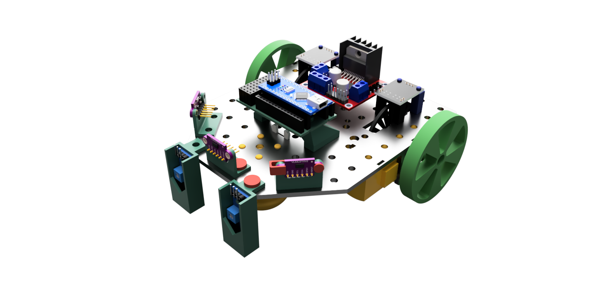

# LibreRover



LibreRover is a open-source, open-hardware educational robot designed for Arduino and robotics workshops.


## Hardware

The hardware parts mostly can be 3D printed. It is designed to fit affordable breakout boards. It is modular and expandable: If you want an encoder, use it. If not, no problem. More sensors? Just print the parts and stick it to the robot.
By using breakout boards for all sensors, the wiring is very flexible, at the cost of lots of wires thorugh the air. For a more permanent setup, consider hot glue and good cable management.


## Software

The Arduino framework is used. Feel free to choose an Arduino Nano (simple), an ESP32 (has WiFi) or another microcontroller. Several classes for an easy start are provided and can be used as needed:
- `Motor`: This makes a simple motor more accessible by taking care of the direction pins and PWM speed control. It is intended to be used with an L298N motor driver.
- `EncoderMotor`: A motor and an encoder together form an EncoderMotor. This class handles both, so the user can easily set the speed and make a wheel move a certain amount.

If you use the Arduino IDE, make sure to add the files in `software/lib/LibreRover` to your project. As an Alternative, consider using PlatformIO.


## Bill of Materials

| Component | Quantity | Estimated Cost | Notes |
|-----------|----------|----------------|-------|
| Arduino Nano | 1 | 3.50 € | Or compatible clone |
| DC Motors with Encoders | 2 | 3.00 € | TT motor; recommended to buy a set with wheels |
| Motor Driver (HW-201 or L298N) | 1 | 2.50 € | Dual H-bridge driver |
| 9V Battery | 1 | 4.00 € | Power supply |
| Jumper Wires | Several | 3.80 € | For connections |
| Light gate LM393 (for simple encoder) | 2 | 3.20 € | optional |
| HW-201 IR reflection sensor | 2 | 1.30 € | optional |
| VL53L0X ToF distance sensor | 3 | 4.00 € | optional |
| Others | - | 1 € | 9 V Battery cable, swith for turning on/off |


**Estimated Total Cost**: ~20 € (excluding 3D printer)


## Hardware assembly

The mechanical parts are in `hardware/mechanical`. The full assembly is shown in `hardware/mechanical/Rover.f3z`.

1. Print the parts that you need:
	- Body
	- Mounting parts for your set of sensors
2. If you print 3D print the wheels (not recommended): Use rubber foam or similar so that they have some grip on the ground.
3. Assemble the motors
	- Screws work best.
	- As an alternative, use the clams `Clamp_Motor_Nose` and `Clamp_Motor_Body` together with `Pin_Motor`.
4. Assemble the glider by sticking it to the body frame. It will be the third contact point with the ground.
5. Assemble the sensors. The sensor mounts are fixed to the body frame with `Simple_pin` and friction. The distance sensors can be fixed to their mounts either by another pin (`Pin_VL53L0X`) or a clamp (`Clamp_VL53L0X`).
6. The 9V battery can be hold in place by `9V_Block_Mounting` on the bottom side of the frame.
7. Wire the electronics.


## Software setup

### Motor

When using the provided class for a simple motor, make sure to setup the correct pins and values.

The `Motor` needs:
- The pins connected to IN1 and IN 2 from the motor driver board (so set the direction).
- The pin connected to EN from the motor driver board. Make sure that PWM is supported on this pin.
- The minimum PWM value at which the motor starts moving. This is used to scale the speed.
- The maximum PWM value. This limits the effective voltage for the motor. Use it, when the motor is made for 6 V instead of the 9 V of the battery: `255 / (battery voltage) * (max. motor voltage)`.

The `EncoderMotor` takes
- The `Motor` to control
- The `SimpleEncoder` attatched to it
- The circumference of the wheel
- The amount of encoder pulses per revolution
- The maximum speed in mm/s.

```cpp
// Motor(forward_pin, backward_pin, pwm_pin, min_pwm, max_pwm)
Motor motor_left(9, 10, 11, 50, 255 / 9. * 6.5);

// EncoderMotor(motor, encoder, mm_per_revolution, pulses_per_revolution, max_speed)
EncoderMotor enc_motor_left(motor_left, encoder_left, 251, 40, 350);
```

## Software Usage

### Basic Movement Example

```cpp
#include <EncoderMotor.h>

// Initialize motors and encoders

void loop() {
    // Drive forward 250mm at 150mm/s
    motor_left.drive_distance(250, 150);
    motor_right.drive_distance(250, 150);
    
    // Wait for completion
    while(!motor_left.is_stopped() || !motor_right.is_stopped()) {
        // Update speed control and stop motor if target distance is reached
		motor_left.tick();
        motor_right.tick();
    }
}
```


## Credits

For creating the CAD files, I used these models:
- Arduino Nano: Arduino Nano by Nithish Cadex: https://grabcad.com/library/arduino-nano-36
- L298N board: Motor Driver L298n by Nithish Cadex: https://grabcad.com/library/motor-driver-l298n-2
- Light gate: IR motor speed encoder arduino WYC H2010 by Ahmed Asem: https://print.grabcad.com/library/ir-motor-speed-encoder-arduino-wyc-h2010-1
- HW-201 IR reflection sensor: HW-201 by Kevin McAleer: https://grabcad.com/library/hw-201-1
- VL53L0X ToF distance sensor: VL53L0X by Darhl Thomason: https://grabcad.com/library/vl53l0x-4

